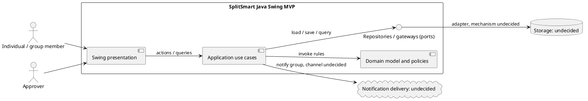

# SplitSmart Architecture and Design Proposal (Codex)

**Status:** Draft proposal pending human review  
**Prepared:** 2026-11-05  
**Repository:** `sakibkabir11/Lab-6`  
**Baseline:** branch `main`, commit `11aa9462114cb4eb1cbe14b6f053a0930781b974`

This is an independent design proposal, not an implementation. It does not rely on generated Spec Kit architecture outputs. FR/NFR/SC labels below are from the specification; D/Q/A labels are local design-decision, question, and assumption identifiers.

## 1. Executive summary

**[Design decision D-01]** Use a small layered Java application: Swing presentation → application use cases → domain rules → adapters through ports. Keep domain and application independent of Swing. This follows the mandated desktop stack and separation of concerns without adding unsupported frameworks (Constitution §§II–IV; NFR-005; FR-MVP-008).

**[Design decision D-02]** Represent users, groups/membership, expenses, approval decisions, obligations, and payments explicitly. Approved expenses give rise to obligations; payments are separate settlement records. Derive outstanding balances from those records so partial settlement does not erase the original obligation (FR-005, FR-007–010, FR-014, FR-019).

**[Design decision D-03]** Use `BigDecimal` for all money. Enforce positive expense amounts and the specified 100% percentage total. Currency, scale, rounding, split remainders, overpayment, and payment allocation remain open; no unsupported financial policy is selected (FR-004, FR-017; Constitution §V).

**[Design decision D-04]** Define persistence and notification boundaries, but select no database, file store, delivery service, or receipt storage. None is established by the inspected project artifacts.

The customer source says the primary platform is web-based. The constitution mandates Swing, and the spec labels a Swing MVP subset. This proposal covers the constitution-compliant Swing MVP; it does not claim that this resolves the web product target (UserRequirement.md; spec assumptions; FR-MVP-001–008).

## 2. Input baseline and inventory

| Item | Evidence |
|---|---|
| Branch / HEAD | `main` / `11aa9462114cb4eb1cbe14b6f053a0930781b974` (`origin/main` at inspection) |
| Working tree | Pre-existing uncommitted changes to `.specify/memory/constitution.md` and `specs/001-splitsmart/spec.md`; read as present, not modified here. |
| Spec identification | One candidate: `specs/001-splitsmart/spec.md`, in the `001-splitsmart` feature directory, with dated Clarifications (2026-10-29) and a linked checklist. File status is `Draft`; no separate Clarify-completion marker found. It is treated as latest clarified source based on sole candidate, structure, and contents. Confirm if `Draft` means Clarify is incomplete. |
| Exact paths read | `docs/architecture/codex-architecture-design-prompt.md`; `docs/architecture/spec-kit-architecture-design-prompt.md`; `docs/architecture/architecture-review-prompt.md`; `.specify/memory/constitution.md`; `specs/001-splitsmart/spec.md`; `specs/001-splitsmart/checklists/requirements.md`; `UserRequirement.md` |
| Missing project artifacts | No `README*`, `pom.xml`, Java source/test files, `.puml`, or `AGENTS.md` found. Thus no existing build, source, tests, or package convention was available. |
| Other customer source | `Lab_6_Requirement.docx` exists but was not parsed. `UserRequirement.md` is explicitly authoritative in the constitution/spec; whether the DOCX adds requirements is unverified. |
| Existing design outputs | No proposal/diagram files found; only the architecture prompts listed above. |

**[Observed current-state fact]** HEAD was the recorded baseline while the two files above had working-tree modifications. This proposal does not attribute those edits to itself.

## 3. Requirements and constraints

### Customer requirements

`UserRequirement.md` calls for accounts, groups, shared expenses with equal/percentage splitting and optional receipt image, notifications, approval, balances, payments, reports, and a primary web-based platform. The clarified spec elaborates these as FR-001–019, NFR-001–010, user stories 1–6, SC-001–006, and the separately labeled FR-MVP-001–008. Authentication, group membership, payer/participants, approval before balance impact, partial payments, history, and privacy are specified requirements. The MVP subset does not replace the complete inventory.

### Constitution constraints

**[Constitution]** Java 21, Maven, Swing, JUnit 5, OOP, cohesion/low coupling, UI/domain separation, `BigDecimal`, requirement traceability, PlantUML where useful, and human review are mandatory (constitution §§II–VIII and Additional Constraints).

**[Open question Q-01]** Is this deliverable specifically the desktop MVP, with web as a later target, or has the product target changed? The answer affects presentation, deployment, notifications, identity, storage, and completion scope. This proposal designs the Swing MVP only.

### Rules evidenced by the specification

- Expense data includes amount, date, description, split method, payer, participants, and optional receipt; amount must be positive (FR-003–005, FR-017).
- Equal and percentage splits are required; percentage values must total exactly 100% (FR-004 and clarification). Decimal input scale and resulting currency allocation are not defined.
- Selected people must be current group members and payer valid for the expense (FR-018). The clarification does not fully state whether payer must be a participant.
- All current group members are notified; at least one designated approver is required; expenses cannot affect balances before approval (FR-006–007, FR-013).
- Partial payments are allowed and reduce outstanding balance while preserving the obligation (clarification; FR-009–010, FR-019).
- Reports cover expenses, balances, payments, date ranges, and other relevant filters (FR-011–012).
- A user sees own information and relevant group context, without unrelated private data (FR-001, FR-015; NFR-003).

## 4. Context and architecture

**[Design decision D-05]** In the MVP context, an authenticated user interacts with a local Swing application. Use cases coordinate domain behavior and ports. Adapters provide storage, notification, and receipt handling only after decisions select mechanisms. No external system is specified; no network identity or notification service is assumed.



The source is also in `diagrams/context-components.puml`. Storage and notification elements are boundaries, not technology selections.

| Component | Responsibility and dependencies | Trace |
|---|---|---|
| `presentation.swing` | Screens, input capture, formatting, navigation, user-visible errors. Calls application interfaces; owns no business rules. | FR-MVP-001–007; NFR-005; Constitution §III |
| `application` | Use-case orchestration, actor authorization, port calls, expected failure mapping, transaction coordination. Depends on domain and ports, never Swing. | FR-001–019 |
| `domain` | Business concepts, invariants, split/approval/payment rules, obligation and balance calculations. No Swing or persistence framework. | FR-003–010, FR-013–019; Constitution §§III–V |
| `application.port` | Persistence and notification interfaces; receipt/authentication boundaries only as needed by chosen design. | Mechanisms open |
| `adapter.*` | Implements ports once storage/delivery choices are made; depends inward. | Mechanisms open |
| tests | JUnit 5 domain, use-case and adapter verification. | Constitution §VI; NFR-007 |

## 5. Package and domain design

**[Design decision D-06]** Names are proposals: no source tree or package convention exists. Establish the root package when the Maven project is defined.

```text
<project-root>.domain
  User, Group, Membership, Expense, ExpenseSplit, SplitMethod
  ApprovalDecision, Obligation, Payment, BalanceCalculator
  ExpensePolicy, domain errors
<project-root>.application
  RegisterUser, AuthenticateUser, CreateGroup, AddGroupMember
  SubmitExpense, ReviewExpense, RecordPayment, GetBalances, GetReport
  request/result types and authorization context
<project-root>.application.port
  UserRepository, GroupRepository, ExpenseRepository, PaymentRepository
  NotificationGateway, ReceiptStore (only if selected)
<project-root>.presentation.swing
  LoginFrame, GroupView, ExpenseForm, ApprovalQueueView, BalanceView, ReportView
<project-root>.adapter.<chosen>
  implementations after technology decisions
```

Class responsibilities are design proposals, not extra requirements:

- `User`: account identity/profile; credential policy is a separate security decision.
- `Group` / `Membership`: group and membership lifecycle; invitation/removal semantics remain open.
- `Expense`: submitted data and review state. Exact transitions, edits, and resubmission after rejection need confirmation.
- `ExpenseSplit`: split method and participant input; derived amounts depend on unresolved financial policies.
- `ApprovalDecision`: records review result; approver/time fields are suggested to support history, pending approval.
- `Obligation`: payer-to-participant amount arising only after approval, linked to source expense. Treatment of payer’s own share is open.
- `Payment`: distinct settlement record. Partial payment preserves obligation; matching, reversal, and overpayment rules are open.
- `BalanceCalculator`: derives pairwise outstanding amounts from approved obligations and payments. Mutable cached balances must not become a second financial source of truth.
- `Report`: query/result view over records, not a separate mutable financial ledger.

See `diagrams/domain-model.puml`; it intentionally omits storage mapping and final monetary value-object rules.

## 6. Use cases and interaction flows

**[Design decision D-07]** A Swing handler gathers input and calls one use case. The use case authorizes the actor, loads relevant state, invokes domain rules, persists accepted state through ports, and returns a result for display. Related state changes must be consistent; transaction mechanism depends on future persistence choice.

### Expense submission and review

1. Member selects group and enters amount/date/description/split/payer/participants/optional receipt.
2. UI performs input-shape feedback only; application checks authenticated actor and group access.
3. Domain validates required values, positive amount, membership/payer eligibility, and percentage total (FR-017–018; clarification).
4. Valid expense is stored pending; notification gateway targets all current group members (FR-006–007). Delivery/retry behavior is open.
5. Designated approver approves/rejects. Record the result; only approval may activate obligations and affect balances (FR-007, FR-013).

Sequence diagram: `diagrams/expense-approval-sequence.puml`.

### Balances, payments, and reports

1. Balance query authorizes group access and loads approved obligations and settlements.
2. Calculator derives pairwise balances with `BigDecimal`; UI only displays the result.
3. Payment use case validates actor, direction, amount, and obligation according to policy; records payment and recalculates. Original obligation remains in history (FR-009–010, FR-019).
4. Report use case queries expense/payment history for selected date range and filters; exact filters and whether balance is current or point-in-time remain open (FR-011–012).

### Other workflows

- Registration/sign-in uses application authentication boundary (FR-001; FR-MVP-001). Credential handling and local/remote identity are undecided.
- Group creation/member addition uses group use cases (FR-002, FR-016; FR-MVP-002). Who can invite/remove and treatment of outstanding obligations are open.
- Swing MVP provides expense entry, approval queue, balance display, payment recording, and basic summary views (FR-MVP-003–007).

## 7. Financial correctness

**[Constitution constraint]** All amounts, payments, obligations, balances, and totals use `BigDecimal`; never `float` or `double` (Constitution §V; NFR-006). Avoid constructing money from binary floating-point. Centralize arithmetic in domain policies, tested independently from Swing.

**[Requirement]** Reject expense amount not greater than zero and percentage totals other than exactly 100% (FR-004, FR-017 and clarification). What “exactly” means for entered decimal precision is unstated.

**Open financial questions:**

- **Q-02 Currency:** single currency or multiple? Where is currency defined, and are conversions allowed?
- **Q-03 Scale/rounding:** monetary scale and rounding mode are unspecified.
- **Q-04 Allocation:** equal or percentage shares can yield sub-cent amounts. How is remainder assigned, or is subunit precision retained?
- **Q-05 Payer:** Must payer participate? Is payer’s own share omitted from owed obligations?
- **Q-06 Settlement:** Can payment exceed outstanding amount? How is one payment allocated across obligations? Can it be reversed or confirmed?
- **Q-07 Lifecycle:** Can payment be recorded before expense approval? The spec raises this edge case but gives no rule.
- **Q-08 Percentages:** Are negative percentages forbidden, and must each participant have an explicit share?

Until answered, exact allocation and settlement invariants cannot be finalized. Keep those rules behind replaceable domain policies.

## 8. Persistence and data ownership

**[Observed fact]** No persistence mechanism or code/configuration was found. **[Design decision]** Define repository ports but select no database or file store. Product decisions should establish durability, backup/recovery, concurrent users, cross-device access, and receipt retention. Store enough linkage among membership, expense, approval, obligation, and payment to support FR-014 history and FR-015 scoped access. Approval and resulting obligation state need consistent persistence; mechanism remains undecided.

## 9. UI, validation, errors, security, and privacy

- Swing owns display, input collection, navigation, and formatting, not split arithmetic, approvals, balances, or authorization (Constitution §III; FR-MVP-008).
- UI may give immediate input feedback, but application/domain validation is authoritative (FR-017–018). Never silently coerce invalid money.
- Represent expected validation, authorization, missing-record, and workflow-state failures as application outcomes. Unexpected infrastructure failures should be logged at a boundary and shown as useful, non-sensitive messages. Logging retention is unspecified; avoid logging passwords, receipt content, or unnecessary financial detail.
- Check authorization at use-case boundaries for group reads/writes; do not trust UI navigation alone (FR-001, FR-015; NFR-003). A desktop client alone may not provide a secure multi-user trust boundary for shared remote data; deployment is open.
- Credential storage, password rules, transport, session lifetime, recovery, and audit access are not specified (NFR-003, FR-014). A simplified login screen does not by itself satisfy security.
- Receipt is part of full FR-003 but absent from FR-MVP-003. Format/size/storage/access and unsupported-file behavior remain open; do not silently remove the full requirement.
- Notifications target current group members per clarification; channel, offline behavior, delivery guarantee, and retry remain open.

## 10. JUnit 5 verification strategy

These are planned scenarios, not executed tests. No Maven project, Java code, or tests currently exist. Exercise real domain behavior; fakes may isolate ports but mock interactions alone do not prove correctness.

| Scenario | Trace |
|---|---|
| Reject zero/negative amount and missing required expense data. | FR-003, FR-017 |
| Accept percentage sum 100%; reject below/above; test precision after input policy is defined. | FR-004 |
| Reject nonmember participants and invalid payer; test payer-participant semantics after Q-05. | FR-018 |
| Pending/rejected expense creates no balance; approval creates obligation once; duplicate review does not apply twice. | FR-007, FR-013–014 |
| Notification request includes every current member; delivery-failure case after policy decision. | FR-006, NFR-004 |
| Pairwise balances for approved payer/participants; verify invariant after allocation rules are fixed. | FR-005, FR-008, NFR-002, NFR-006 |
| Partial/full payment lowers outstanding amount and preserves original obligation/history. | FR-009–010, FR-019, NFR-008 |
| User cannot read unrelated private data; authorized member can access relevant group context. | FR-001, FR-015, NFR-003 |
| Create group/add member/multiple groups; removal lifecycle after policy decision. | FR-002, FR-016 |
| Date-boundary report filters reconcile to transaction records; empty range after clarification. | FR-011–012, SC-005, NFR-010 |
| Persistence round-trip for linked history and atomic approval state after store selection. | FR-014, NFR-008 |
| End-to-end MVP workflow: login, group, submit/review, balances, payment, summary. | FR-MVP-001–008; SC-001–006 |

NFR-009 has no scale target and SC-004 has an undefined test-suite denominator; define both before performance/acceptance verification.

## 11. Requirement-to-design-to-test traceability

| Requirement | Design elements | Planned verification |
|---|---|---|
| FR-001 | Authentication use case, authorization context, `User` | Account and access-isolation tests |
| FR-002, FR-016 | `Group`, `Membership`, group use cases | Create/add/multiple-group tests |
| FR-003 | `Expense`, `ExpenseSplit`, optional receipt boundary | Required-field tests; receipt handling deferred |
| FR-004 | Split validation/policy | Equal/percentage tests; remainder unresolved |
| FR-005 | Payer, participants, obligations | Payer/participant test; own-share policy open |
| FR-006 | `NotificationGateway` on submission | Current-member recipient test |
| FR-007, FR-013 | Expense lifecycle, `ApprovalDecision` | Pending/rejected no balance; approval once |
| FR-008 | `BalanceCalculator` over approved obligations/payments | Pairwise scenarios after allocation policy |
| FR-009–010, FR-019 | `Payment`, preserved obligation | Partial/full settlement and history tests |
| FR-011–012 | Report query/use case | Date filters and reconciliation scenarios |
| FR-014 | Linked expense/approval/payment records | History and persistence tests after store choice |
| FR-015 | Use-case authorization and scoped query | Cross-user/group privacy tests |
| FR-017–018 | Domain validation | Invalid data, membership, payer tests |
| NFR-001 | Swing workflow | Human usability review; SC-001/003 timing |
| NFR-002, NFR-006 | BigDecimal domain calculator | Arithmetic/invariant tests after policy decisions |
| NFR-003 | Authentication/authorization boundary | Access tests and deployment security review |
| NFR-004 | Approval state, notification port | State/recipient tests; delivery policy open |
| NFR-005 | Layer and dependency direction | Architecture review when code exists |
| NFR-007 | JUnit 5 and matrix | Coverage/acceptance-suite review |
| NFR-008 | Linked history | Approval/payment history tests |
| NFR-009 | No scale design commitment yet | Set target, then performance tests |
| NFR-010 | Report query and reconciliation | Date summary reconciliation tests |
| FR-MVP-001 | Swing login/auth use case | Login acceptance flow |
| FR-MVP-002 | Group UI/use cases | Create/select group flow |
| FR-MVP-003 | Expense form/use case | Expense entry flow |
| FR-MVP-004 | Approval queue | Pending queue flow |
| FR-MVP-005 | Balance view/calculator | Group balance display |
| FR-MVP-006 | Payment UI/use case | Record and refresh balance |
| FR-MVP-007 | Report view/query | Summary flow |
| FR-MVP-008 | Presentation/application/domain separation | Architecture review and domain-only tests |
| SC-001, SC-003 | Onboarding/payment flows | Timed usability acceptance |
| SC-002, SC-006 | Balance/approval rules | Acceptance scenarios after financial policies |
| SC-004 | Acceptance suite | Define scope and demonstrate ≥95%; denominator open |
| SC-005 | Report query | Compare totals with underlying transactions |

## 12. Alternatives and trade-offs

- **Put rules in Swing handlers:** fewer initial classes, but violates explicit separation and impedes financial testing; rejected (Constitution §III; FR-MVP-008).
- **Small layered design:** modest structure, allows domain tests without UI; selected (D-01). Avoid adding mediator/DI frameworks without demonstrated need.
- **Microservices/web backend now:** might fit web-first source, but no deployment/network/concurrency requirements and constitution mandates Swing. Not proposed; Q-01 remains unresolved.
- **Mutable balance as financial source:** fast reads but risks drift with partial payments and history. Prefer deriving from obligations and settlements; optimize only with evidence and reconciliation (FR-008–010, NFR-008–009).
- **Choose database or storage now:** unsupported by repository or requirements; defer behind ports.
- **Add dependencies/frameworks:** none justified by inspected inputs; defer until project structure and need are known.

## 13. Assumptions, risks, open questions

### Assumptions

- **A-01:** The sole feature spec is latest clarified source because it has dated clarifications and a checklist. `Draft` remains a caveat, not approval evidence.
- **A-02:** This proposal is for the mandated Swing MVP; web-first scope remains a product question.
- **A-03:** Linkable expense/approval/payment history is needed for stated audit requirements; exact fields/retention remain open.

### Risks

- Unresolved money policies prevent final share/settlement invariants and could affect persisted data.
- Web/Swing target conflict could invalidate presentation/deployment choices.
- Authentication/privacy needs exceed “simplified login”; trust boundary and credential handling are undefined.
- Notification, receipt, and persistence mechanisms are required concepts without delivery/storage policies.
- NFR-009 and SC-004 lack measurable scale/test-suite definitions.
- Unparsed `Lab_6_Requirement.docx` may contain additional requirements; confirm if it is authoritative in addition to `UserRequirement.md`.

### Prioritized decisions

1. Confirm web target versus Swing MVP scope.
2. Define currency, scale/rounding, equal/percentage remainder allocation.
3. Define payer participation and own-share treatment.
4. Define overpayment, payment allocation/reversal, and payment before approval.
5. Define percentage constraints and per-participant input rules.
6. Specify persistence durability/deployment, concurrent access, and receipt handling.
7. Specify notification channel, retry, and offline behavior.
8. Specify authentication/security/session/recovery for deployment.
9. Define group ownership/removal and outstanding-debt lifecycle.
10. Define report filters, balance time semantics, and empty-range behavior.
11. Define NFR-009 scale target and SC-004 denominator.
12. Confirm whether the DOCX adds authoritative requirements.

## 14. Human review checklist

- [ ] Confirm the spec is approved post-Clarify despite `Status: Draft`.
- [ ] Confirm baseline SHA and pre-existing working-tree edits are the intended baseline.
- [ ] Resolve web target versus Swing MVP scope.
- [ ] Approve financial policies before implementing allocation/settlement.
- [ ] Approve persistence, authentication, notification, receipt, and deployment decisions.
- [ ] Confirm full customer feature inventory and DOCX authority.
- [ ] Review package/class boundaries and lifecycle rules against future codebase conventions.
- [ ] Define NFR-009/SC-004 measurable criteria.
- [ ] Review diagrams; ensure unresolved choices are not read as selected policy/technology.

## 15. Checks and deliverables

**Checks performed:** Read the complete listed constitution, sole candidate spec, customer source, checklist, and architecture prompt/review documents; inspected Git branch/status/history and repository file inventory; checked for README/build/source/test/diagram/agent guidance; mapped each FR, NFR, MVP FR, and SC above; kept unspecified financial policies explicit.

**Not performed:** No build, test, or PlantUML rendering was run; no application project exists and this is a design-only task.

**Unresolved:** Q-01–Q-08 and §13 decisions remain. Proposal and diagrams are drafts pending human review.
